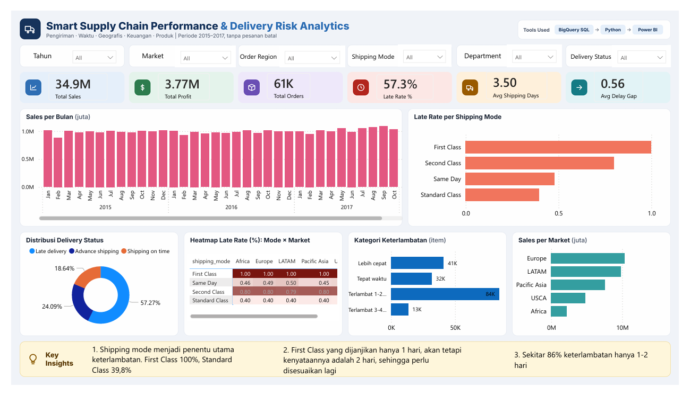

# Smart Supply Chain Performance & Delivery Risk Analytics

Analisis keterlambatan pengiriman pada data supply chain periode 2015-2017 untuk menjawab satu pertanyaan bisnis: **faktor apa yang paling menentukan keterlambatan pengiriman?**

**Alur kerja:** BigQuery SQL → Python (Google Colab) → Power BI



---

## Ringkasan Temuan

| Metrik | Nilai |
|---|---|
| Total pesanan (order unik) | 60.860 |
| Total item pesanan | 170.728 |
| Total sales | 34,90 juta |
| Total profit | 3,77 juta (margin 10,81%) |
| Late rate | 57,27% (97.782 item) |
| Rata-rata lama pengiriman | 3,50 hari |
| Avg delay gap | 0,56 hari |

**Temuan utama**

1. **Shipping mode adalah satu-satunya penentu keterlambatan yang terlihat.** Late rate: First Class 100%, Second Class 79,82%, Same Day 47,97%, Standard Class 39,76%.
2. **Janji pengiriman First Class tidak realistis.** Dijadwalkan 1 hari, realisasinya selalu 2 hari. Second Class dijadwalkan 2 hari dengan rata-rata realisasi 3,99 hari (selisih rata-rata 1,99 hari).
3. **Mayoritas keterlambatan ringan.** Sekitar 86% item terlambat hanya 1-2 hari (84.481 dari 97.782). Keterlambatan 3-4 hari (13.301 item) seluruhnya berasal dari Second Class.
4. **Faktor lain hampir tidak berpengaruh.** Late rate seragam antar market (56,84% - 57,69%), antar kategori produk, dan antar departemen. Heatmap mode × market menunjukkan pola yang sama di semua market.
5. **Keterlambatan hampir tidak memengaruhi profit.** Margin rata-rata item terlambat 10,7% vs 11,0% untuk yang tidak terlambat.

**Rekomendasi bisnis**

- Sesuaikan janji First Class dari 1 hari menjadi 2 hari, atau perbaiki proses operasionalnya agar benar-benar 1 hari.
- Tinjau juga janji Second Class (dijanjikan 2 hari, realisasi rata-rata 4 hari).
- Gunakan Standard Class sebagai acuan: janji 4 hari dengan realisasi 3,99 hari menunjukkan estimasi yang paling akurat.

---

## Dataset

- Sumber: [DataCo Smart Supply Chain for Big Data Analysis (Kaggle)](https://www.kaggle.com/datasets/shashwatwork/dataco-smart-supply-chain-for-big-data-analysis)
- Dipilih 18 variabel dari data asli dan periode 1 Januari 2015 - 31 Desember 2017.
- Pesanan batal (`Shipping canceled`, 7.668 item) dikeluarkan dari analisis.
- Data mentah tidak disertakan di repository ini. Unduh dari link Kaggle di atas (cek lisensi dataset sebelum digunakan ulang).

Variabel yang digunakan: `order_id`, `order_item_id`, `order_date`, `shipping_date`, `days_for_shipping_real`, `days_for_shipment_scheduled`, `delivery_status`, `late_delivery_risk`, `shipping_mode`, `market`, `order_region`, `order_country`, `order_state`, `sales`, `benefit_per_order`, `order_item_quantity`, `category_name`, `department_name`.

## Proses

### 1. SQL (BigQuery) — [`sql/supply_chain_analysis.sql`](sql/supply_chain_analysis.sql)
- Eksplorasi tabel mentah (jumlah baris, nama kolom, tipe data).
- Membuat view `vw_supply_chain` berisi 18 variabel dengan nama kolom snake_case.
- Cek kualitas data: distribusi status, missing value, duplikat `order_item_id`, nilai tidak wajar (sales ≤ 0, hari kirim negatif, kirim sebelum order).
- Filter periode 2015-2017 (`vw_supply_chain_filtered`).
- Query KPI utama dan late rate per shipping mode.
- Membuat tabel `supply_chain_final` dengan kolom turunan: `delay_gap`, `is_late`, `order_year`, `order_month`, `profit_margin`.

### 2. Python (Google Colab) — [`notebooks/supply_chain_analysis.ipynb`](notebooks/supply_chain_analysis.ipynb)
- Menarik `supply_chain_final` dari BigQuery.
- Mengeluarkan pesanan batal, lalu memverifikasi KPI terhadap hasil SQL.
- Analisis late rate per shipping mode, market, region, kategori, departemen, dan negara.
- Analisis sebaran `delay_gap`, hubungan keterlambatan dengan profit, dan kategori keterlambatan.
- Mengekspor data bersih (170.728 baris, 26 kolom) untuk Power BI.

### 3. Power BI — [`powerbi/supply_chain_dashboard.pbix`](powerbi/supply_chain_dashboard.pbix)
Dashboard dengan filter Tahun, Market, Order Region, Shipping Mode, Department, dan Delivery Status. Visual: KPI, sales per bulan, late rate per shipping mode, distribusi delivery status, heatmap mode × market, kategori keterlambatan, dan sales per market.

## Definisi Metrik

- **delay_gap** = `days_for_shipping_real − days_for_shipment_scheduled` (positif berarti lebih lambat dari jadwal).
- **Late rate** = proporsi item dengan `delivery_status = 'Late delivery'`. Dihitung **per item pesanan**, bukan per order.
- **Total Orders** dihitung per `order_id` unik, sedangkan late rate dan kategori keterlambatan dihitung per item.

## Catatan dan Limitasi

- **Perubahan pola data sejak Oktober 2017.** Rata-rata item per order turun dari sekitar 3,0 menjadi sekitar 1,0, sementara jumlah order tetap. Penurunan sales pada November-Desember 2017 di dashboard mencerminkan perubahan pola ini, bukan penurunan jumlah pesanan. Periode ini diberi penanda `order_period_flag` pada data ekspor.
- **`late_delivery_risk` identik dengan status `Late delivery`** (crosstab menunjukkan keduanya sepenuhnya sejajar), sehingga kolom ini tidak layak dipakai sebagai prediktor karena menyebabkan data leakage.
- **Pola data sangat seragam** (misalnya Standard Class tepat sekitar 40% di semua market, First Class selalu 100%). Hal ini menunjukkan dataset kemungkinan bersifat sintetis, sehingga temuan lebih tepat dipandang sebagai latihan analisis daripada kesimpulan tentang operasional nyata.
- Analisis bersifat deskriptif. Tidak dilakukan pemodelan prediktif atau uji statistik.

## Struktur Repository

```
smart-supply-chain-delivery-risk/
├── README.md
├── sql/
│   └── supply_chain_analysis.sql
├── notebooks/
│   └── supply_chain_analysis.ipynb
├── powerbi/
│   └── supply_chain_dashboard.pbix
├── images/
│   └── dashboard.png
└── presentation/
    └── project_summary.pdf
```

## Cara Mereproduksi

1. Unggah `DataCoSupplyChainDataset.csv` ke BigQuery sebagai tabel `SupplyChain.SupplyChain`.
2. Jalankan `sql/supply_chain_analysis.sql` secara berurutan sampai tabel `supply_chain_final` terbentuk. Ganti project ID `supply-chain-513612` dengan project Anda.
3. Buka notebook di Google Colab, ubah `PROJECT_ID`, lalu jalankan semua sel. Library: `pandas`, `numpy`, `matplotlib`, `seaborn`, `pandas-gbq`.
4. Impor `supply_chain_clean.csv` hasil ekspor ke Power BI Desktop, lalu buka `.pbix` atau bangun ulang visualnya.

## Kontak

Wiwil Dzil Izzatil · [LinkedIn](https://www.linkedin.com/in/wiwildzilizzatil) · [GitHub](https://github.com/wiwildzilizzatil)
